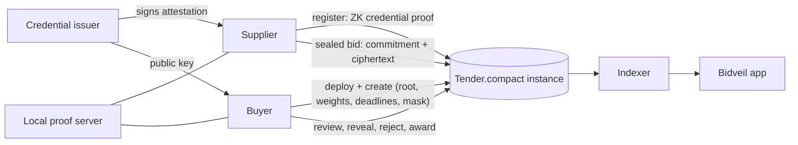
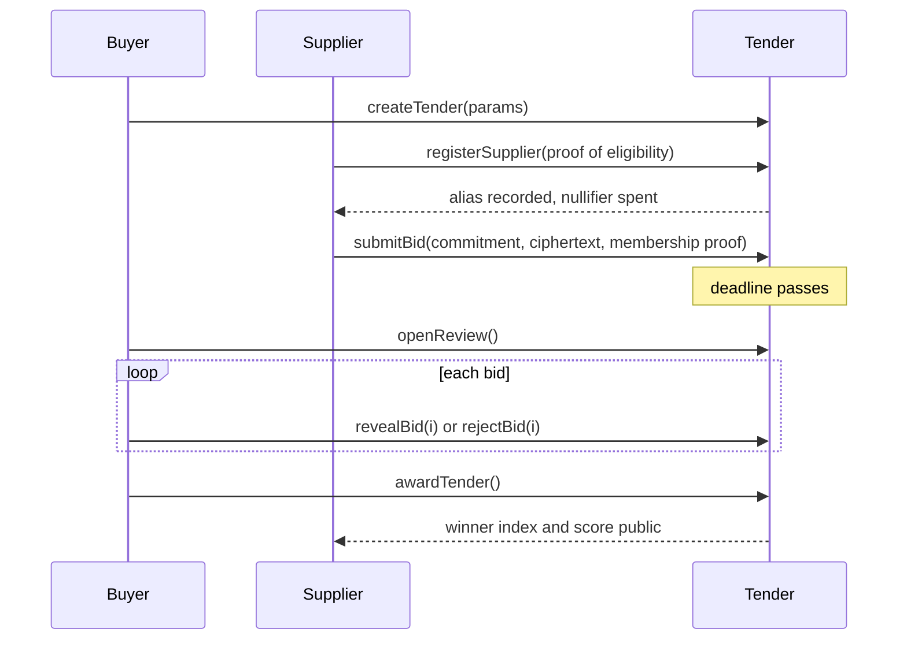

# Tender.compact: Design Doc

## 1. Metadata

| Field | Value |
| --- | --- |
| Status | Draft (In Review) |
| Target chain | Midnight (Preview, then Preprod) |
| Language | Compact, `pragma language_version 0.28`, compiler 0.36.0, Compact runtime 0.21.0 (matrix from the Midnight install docs, checked 14 Nov 2026) |
| Proof server | `midnightntwrk/proof-server:9.0.0` |
| Milestone | Bidveil Phase 2 (contract), feeds Phase 3 (integration) and Phase 4 (submission quality) |
| Deploy model | One contract instance per tender, immutable |

Review tracker
- [ ] Design review
- [ ] Security review
- [ ] Privacy/disclosure review (what each circuit discloses)
- [ ] Ops review (proof server, indexer, wallet flow)

Scope note: this doc is the deliverable for this session. No Compact source was written, compiled, or deployed here. Implement and compile it in a Midnight toolchain environment.

## 2. Action Items (living)

- None yet.

## 3. Goals / Non-Goals

Goals
- Buyer publishes a tender with fixed rules: bid deadline, review deadline, scoring weights, reveal policy, credential requirements.
- Suppliers prove eligibility in zero knowledge, without revealing the credential.
- Suppliers submit sealed bids. Nobody, including other suppliers, can read them.
- Buyer opens a review window after the deadline, reveals only the policy-approved fields, and awards the highest weighted score.
- Every state transition is publicly auditable without exposing sealed content.

Non-Goals
- Holding or moving funds (no escrow, no payment in v1).
- Upgradeability, pause, or admin override (chosen: immutable, no pause).
- Hiding bid contents from the buyer. The buyer must read bids to evaluate them.
- Credential issuance and revocation infrastructure (the issuer is an external actor).
- Multi-buyer or committee approval (chosen: buyer key only).
- Cross-contract registry of tenders (the app indexes instances).

## 4. Requirements

Functional
- F1 Create tender (once per instance).
- F2 Register supplier with a private credential proof (issuer-signed attestation verified in zero knowledge).
- F3 Verify eligibility result (public, per alias).
- F4 Submit sealed bid (once per supplier).
- F5 Open review window (buyer, after deadline).
- F6 Reveal approved fields of one bid (buyer, review window).
- F7 Record award (buyer, only the highest weighted score).
- F8 Reject an unopenable bid (buyer, review window, public reason code). Added to keep the tender live when a supplier submits a bad package; not in your original list.

Security (testable assertions)
- S1 No circuit other than F1 succeeds unless it runs in the correct phase.
- S2 Only the holder of the buyer secret can run F5, F6, F7, F8.
- S3 A credential id can register at most one supplier alias per tender.
- S4 A supplier alias can submit at most one bid per tender.
- S5 An ineligible or unregistered supplier cannot submit a bid.
- S6 A revealed bid always matches its on-chain commitment.
- S7 Disclosed fields never exceed the reveal policy mask.
- S8 The award can only go to the bid with the highest recorded weighted score; ties go to the earliest bid index.
- S9 Award requires every submitted bid to be revealed or rejected.
- S10 Hashes and nullifiers are domain-separated and bound to the tender id, so nothing replays across tenders.
- S11 Bid submission is unlinkable to the registration alias.

## 5. Terminology & Actors

Terms
- Alias: pseudonymous supplier identity for one tender, `hash(domain, tenderId, supplierSecret)`.
- Attestation: a Schnorr signature by the credential issuer over the supplier's attributes, the supplier's derived public key (so it cannot be lent), a unique credential id, and an expiry. Verified inside the proof, as in Midnight's ZK Loan tutorial.
- Nullifier: public one-time tag that blocks reuse without revealing who used it.
- Witness: private TypeScript function supplying secret inputs to a circuit. Witness output is untrusted until the circuit constrains it.
- Disclose: explicit act of making a private value public.
- Reveal mask: bitmask fixed at creation of which bid fields may be disclosed.

| Actor | Onchain/offchain | Trust | Can do |
| --- | --- | --- | --- |
| Buyer | Both (key offchain) | Semi-trusted for bid confidentiality and scoring; not trusted to break rules | Create, open review, reveal, reject, award |
| Supplier | Both | Untrusted | Register, submit one bid |
| Credential issuer | Offchain | Trusted for credential truth | Signs supplier attestations; its public key is pinned at tender creation |
| Other suppliers / public | Offchain | Untrusted | Read public ledger only |
| Proof server | Local to the user | Trusted by its operator | Generates proofs; sees private inputs |
| Indexer / RPC | Offchain | Untrusted | Serves public state |

## 6. Language / Runtime

- Compact compiles to zero-knowledge circuits. Each exported circuit becomes a transaction proven client-side and verified by the network.
- Public state lives in the `ledger`. Private state lives in the user's local private-state store and is reachable only through witnesses.
- Pinned toolchain: `compact update 0.36.0`, language 0.28, runtime 0.21.0, proof server 9.0.0. Never run a bare `compact update`, because it can install a release that targets a ledger version the networks don't run yet. Record the versions in the README.
- Preview and Preprod run ledger 9 (Preview relaunched 7 Nov 2026). Check the release page for the current Preprod state before deploying.
- Base libraries: Compact standard library only. It provides `persistentHash`, `persistentCommit`, `jubjubSchnorrVerify`, `merkleTreePathRoot`, `blockTimeLt`/`blockTimeGte`, and the `Counter`, `Map`, `Set`, `HistoricMerkleTree` ledger types. No other base contracts.

## 7. Transaction & Execution Model

- One circuit call is one atomic transaction: all ledger writes commit or none do.
- No reentrancy surface: Compact has no external calls to untrusted contracts. This contract calls no other contract.
- All checks run inside the circuit. A witness can return anything, so every witness value must be constrained (hash-bound, range-checked, or membership-checked) before use.
- Time uses block time comparisons against public deadlines, with tolerance (see section 15).

## 8. Chain Standards & Interfaces

- No token standard. The contract holds no assets.
- Wallet interface: the Midnight wallet connector in the browser (Phase 3).
- No EVM role mapping applies. Buyer authority is a secret-key commitment, not an address.

## 9. Architecture Overview





Flow of state (no funds)
| Step | Who changes what | Invariant |
| --- | --- | --- |
| create | Buyer sets params | Params are write-once |
| register | Supplier adds alias leaf, spends credential nullifier | One alias per credential |
| bid | Supplier adds commitment, spends bid nullifier | One bid per alias |
| review | Buyer flips phase | Only after the deadline |
| reveal/reject | Buyer resolves one bid | Each bid resolved exactly once |
| award | Buyer records winner | Winner is the max score; all bids resolved |

Resting-state invariant: the contract holds no value, so there is nothing to drain.

Dependencies: Midnight network and indexer, local proof server, wallet connector, an external credential issuer's published root. App assumption: ciphertexts reach the buyer through the on-chain ciphertext field, not a server.

## 10. Contract Design

### Roles
| Role | Holder | Permissions | Why |
| --- | --- | --- | --- |
| Buyer | Holder of the buyer secret (commitment stored on ledger) | openReview, revealBid, rejectBid, awardTender | Sole procurement authority by your choice |
| Supplier | Any holder of a valid credential | register, submit | Permissionless, proof-gated |

There is no pause role, no upgrade role, and no owner transfer. If the buyer key is lost, the tender stalls with no funds at risk (see section 18).

### Ledger state (public)
| Name | Type | Meaning |
| --- | --- | --- |
| `phase` | enum Open, Review, Awarded | Lifecycle |
| `initialized` | Boolean | Blocks a second create |
| `tenderId` | Bytes<32> | Domain separation input |
| `buyerCommit` | Bytes<32> | `hash(BUYER_DOMAIN, tenderId, buyerSecret)` |
| `issuerKey` | JubjubPoint | Public key of the credential issuer the buyer accepts |
| `requirements` | struct: requiredCertMask, minYears, accreditedJurisdictions mask | Public rules suppliers prove against |
| `weights` | Vector<4, Uint<32>> | Scoring weights, fixed at creation |
| `priceCeiling` | Uint<64> | Maximum acceptable price |
| `revealMask` | Uint<8> | Which fields may be disclosed |
| `bidDeadline`, `reviewDeadline` | Uint<64> | Block-time bounds |
| `aliasTree` | HistoricMerkleTree<10, Bytes<32>> | Registered alias leaves (capacity 1024) |
| `credentialNullifiers` | Set<Bytes<32>> | Spent credential tags |
| `bidNullifiers` | Set<Bytes<32>> | Spent bid tags |
| `bidCount` | Counter | Number of bids |
| `bidCommitments` | Map<Uint<32>, Bytes<32>> | Index to bid commitment |
| `bidCiphertexts` | Map<Uint<32>, Bytes<512>> | Index to ciphertext for the buyer |
| `bidStatus` | Map<Uint<32>, enum Sealed, Revealed, Rejected> | Per-bid status |
| `resolvedCount` | Counter | Revealed plus rejected |
| `revealed` | Map<Uint<32>, RevealedBid> | Policy-limited disclosed fields plus score |
| `bestIndex`, `bestScore` | Uint<32>, Uint<128> | Running winner |
| `winnerIndex` | Uint<32> | Final award |

### Private state
- Supplier: supplier secret, issuer attestation, alias Merkle path, salts, plaintext bid.
- Buyer: buyer secret, encryption key, decrypted bid packages, evaluator scores.

### Witnesses (all untrusted until constrained)
`buyerSecret()`, `supplierSecret()`, `attestation()` (attributes, credential id, expiry, issuer signature), `aliasPath()`, `bidPlaintext()`, `bidSalt()`, `openedBid(index)`, `evaluatorScores(index)`.

### Scoring
`score = w0 * (priceCeiling - price) + w1*q1 + w2*q2 + w3*q3`
- `price` is the supplier's committed price, required to be at most `priceCeiling`.
- `q1..q3` are evaluator scores in 0..100, assigned by the buyer at reveal, not self-claimed by the supplier.
- No division in circuit. The buyer picks weights that make the units comparable.
- Score uses Uint<128> so the sum cannot overflow with Uint<64> price and Uint<32> weights.

### Write circuits
| Circuit | Caller | State mutated | Reverts when |
| --- | --- | --- | --- |
| `createTender(params)` | Deployer, once | All params, `buyerCommit`, phase Open | already initialized; deadlines not ordered; weights all zero; mask has unknown bits |
| `registerSupplier()` | Any supplier | Appends alias leaf, spends credential nullifier | phase not Open; past bid deadline; signature invalid for `issuerKey`; attestation not bound to caller's key; expired; attributes fail requirements; nullifier already spent |
| `submitBid(commitment, ciphertext)` | Any registered supplier | Spends bid nullifier, appends bid, status Sealed | phase not Open; past deadline; alias path not in `aliasTree`; nullifier spent; committed price above ceiling |
| `openReview()` | Buyer | phase Review | not buyer; before deadline; phase not Open |
| `revealBid(index)` | Buyer | status Revealed, writes masked fields and score, updates best | not buyer; phase not Review; past review deadline; status not Sealed; opening does not match commitment; evaluator score above 100 |
| `rejectBid(index, reason)` | Buyer | status Rejected, public reason code | not buyer; phase not Review; status not Sealed |
| `awardTender()` | Buyer | phase Awarded, `winnerIndex` | not buyer; phase not Review; `resolvedCount != bidCount`; no revealed bid |

Read side (no transaction)
- `isEligible(alias)`: reads the ledger to confirm an alias registered. This is F3. The eligibility proof itself is verified by the network inside `registerSupplier`, so "verify" is a public receipt, not a second proof.
- Public getters for phase, counts, winner, revealed rows.

### Pseudocode: registerSupplier
```
assert phase == Open and blockTime < bidDeadline
a = attestation()                                                     // private witness
assert a.supplierKey == derivePublicKey(supplierSecret())            // bound to caller, not lendable
assert jubjubSchnorrVerify([a.supplierKey, a.certMask, a.years, a.jurisdiction, a.credentialId, a.expiry],
                           a.signature, issuerKey)                    // issuer signed these exact values
assert blockTimeLt(a.expiry)
assert meetsRequirements(a, requirements)                            // all checks private
cNull     = hash(CRED_NULL_DOMAIN, tenderId, a.credentialId)
assert !credentialNullifiers.member(cNull)
credentialNullifiers.insert(disclose(cNull))
aliasLeaf = hash(ALIAS_DOMAIN, tenderId, supplierSecret())
aliasTree.insert(disclose(aliasLeaf))
```

### Pseudocode: submitBid
```
assert phase == Open and blockTime < bidDeadline
aliasLeaf = hash(ALIAS_DOMAIN, tenderId, supplierSecret())
assert merklePathRoot(aliasPath(aliasLeaf)) is a known aliasTree root
bNull = hash(BID_NULL_DOMAIN, tenderId, supplierSecret())            // not derived from aliasLeaf
assert !bidNullifiers.member(bNull)
assert plaintext.price <= priceCeiling
assert commitment == commit(BID_DOMAIN, tenderId, plaintext, salt)
bidNullifiers.insert(disclose(bNull)); store commitment, ciphertext; bidCount += 1
```

### Pseudocode: revealBid
```
assert buyerCommit == hash(BUYER_DOMAIN, tenderId, buyerSecret())
assert phase == Review and bidStatus[i] == Sealed
opened = openedBid(i)
assert commit(BID_DOMAIN, tenderId, opened.plaintext, opened.salt) == bidCommitments[i]
q = evaluatorScores(i); assert each q <= 100
score = w0*(priceCeiling - opened.price) + w1*q1 + w2*q2 + w3*q3
write revealed[i] = { price: mask.price ? opened.price : 0, scores: mask.scores ? q : 0, score }
if score > bestScore: bestScore = score; bestIndex = i       // strict: earliest wins ties
bidStatus[i] = Revealed; resolvedCount += 1
```
Note on tie handling: the strict greater-than check makes the earliest resolved bid win a tie. Because the buyer chooses reveal order, the tie rule should use bid index, not reveal order: compare `(score, lowerIndex)`. The implementation must do this.

### Observability
Compact has no event log. Phase, counters, and per-index status changes in the ledger are the monitoring surface, read through the indexer.

## 11. Specification tables

### Reveal policy
Principle: the total weighted score and the winner index are always public. Everything else follows the mask.

| Mask bit | Field | If clear |
| --- | --- | --- |
| 0 | Price | Disclosed as 0 |
| 1 | Evaluator criterion scores | Disclosed as 0 |
| 2 | Proposal hash | Not stored |

| Functionality | Restriction | Event/Effect | Chain-Specific Adjustment |
| --- | --- | --- | --- |
| Read tender status | Anyone | none | |
| Register | Credential proof, Open phase | Alias leaf added | Eligibility is a ZK proof, not an address allowlist |
| Bid | Alias proof, Open phase | Commitment stored | Unlinkable to alias |
| Reveal | Buyer only, Review phase | Masked row stored | Conditional disclosure by mask |
| Award | Buyer only, all bids resolved | Winner stored | Winner is forced to be the max score |

## 12. Deployment & Initialization

1. Buyer generates a buyer secret locally and derives `buyerCommit`.
2. Buyer picks the credential issuer's public key.
3. Deploy, then call `createTender` in the same wallet session.
4. Resolved by the docs: Midnight's ZK Loan constructor reads a witness secret and pins a derived key into the ledger. So "Create tender" is the constructor: params are constructor arguments and `buyerCommit` is derived from the buyer secret witness. There is no separate `createTender` circuit and no front-run window.
5. No funds are needed at the contract. The buyer wallet needs testnet fee tokens only.

## 13. Upgradeability

None. Immutable by your choice. Migration story: contract switch. A bug fix means a new instance with a new address. Open tenders finish on the old instance, and the app re-points new tenders to the new one. This costs nothing in value because no funds are held.

## 14. Key Management & Signing

- Buyer secret: 32 random bytes held in private state. Back it up. Loss freezes only that tender.
- Supplier secret: 32 random bytes in private state, one per supplier identity. Alias and nullifiers derive from it with distinct domains.
- No signature scheme. Authority is proof of knowledge of the secret behind a stored commitment.
- Replay protection: `tenderId` is inside every hash and nullifier, so proofs cannot transfer across tenders.
- Bid salts: fresh 32 random bytes per bid.

## 15. Security Considerations

| Vulnerability | Applicable? | Mitigation |
| --- | --- | --- |
| Reentrancy | No | No external calls |
| Access control | Yes | Buyer commitment check in every buyer circuit |
| Integer overflow | Yes | Uint widths chosen above; score in Uint<128> |
| Malicious witness | Yes | Every witness value constrained in circuit |
| Accidental disclosure | Yes | Review every `disclose` call; test that private fields never reach ledger |
| Nullifier/commitment replay | Yes | Domain separation plus `tenderId` |
| Nullifier linkability | Yes | Bid nullifier not derived from alias leaf |
| Credential revocation | Yes | No revocation list. Attestations carry an expiry; the issuer uses short expiries or rotates keys (a new tender pins the new key) |
| Forged attestation (unconstrained witness arithmetic) | Yes | Use the standard library verifier; add a forged-signature regression test, as Midnight's ZK Loan suite does |
| Sybil registration | Yes | One alias per credential via credential nullifier |
| Front-running create | Yes | See section 12 |
| Time dependence | Yes | Deadlines compare block time; tolerance stated in app copy, not used for randomness |
| Timing/metadata leakage | Yes | Submission timing and transaction size are public; fixed-size ciphertext and bid padding |
| Merkle capacity DoS | Yes | 1024 alias leaves, an attacker needs 1024 real credentials |
| Weak randomness | Yes | Salts and secrets from a CSPRNG only |
| Buyer withholding / bias | Yes | Public rules, public scores, award forced to max, reject is public |
| Bid ciphertext griefing | Yes | `rejectBid` with a public reason |
| Centralization | Yes | Buyer is a single key by choice; documented in section 16 |
| Compiler/runtime bugs | Yes | Pin versions; record in README |

## 16. Trust Model & Threat Analysis

| Actor | Max damage if compromised or malicious | Mitigation | Detection |
| --- | --- | --- | --- |
| Buyer key | Reads all bids, assigns biased criterion scores, rejects or withholds bids, stalls the tender | Weights and mask fixed at creation; scores and rejections public; award cannot skip max score | Anyone auditing the ledger sees rejections and scores |
| Supplier key | Lose that supplier's own bid | Per-tender alias; one credential spent | n/a |
| Credential issuer | Wrongly accredits suppliers | Buyer chooses which root to trust | Public root in ledger |
| Proof server host | Sees private inputs | Run locally | n/a |

Honest limit: confidentiality of a bid against the buyer is not provided. Integrity against the buyer is.

## 17. Emergency Response & Circuit Breakers

None by design (no pause, no admin). Incident response is redeploying a new instance (section 13). Rescue of stuck assets is not applicable because the contract holds none.

## 18. Failure Scenarios

- Buyer key lost: tender stays in its phase forever. No funds locked. Suppliers lose only time.
- Buyer never opens review: same stall. Mitigation is buyer-side tooling and a published review deadline. No force-open exists.
- Supplier's ciphertext is garbage: buyer runs `rejectBid`, so award is not blocked.
- Duplicate bid attempt: bid nullifier already spent, circuit reverts.
- Same credential registers twice: credential nullifier spent, reverts.
- Reveal with wrong opening: commitment mismatch, reverts, status unchanged.
- Proof generation fails or times out: transaction is never submitted, no state change.

## 19. Priorities & Tradeoffs

| Decision | Tradeoff | Rejected alternative |
| --- | --- | --- |
| Instance per tender | More deployments | One contract with a map of tenders: larger state, shared blast radius |
| Merkle credential proof | Needs an issuer-published root | Address allowlist: leaks who is eligible |
| Buyer-assigned criterion scores | Buyer subjectivity | Supplier self-claimed scores: unverifiable |
| Ciphertext onchain | State cost, size-limited | Offchain delivery: bids can be unopenable |
| Immutable, no pause | No emergency stop | Pauser or cancel: more trust surface |
| Buyer key only | Single point of failure | Two-approver reveal: more flow |

## 20. Testing Strategy

Layers
1. Simulator tests: the compiler's generated TypeScript contract run in memory with mock witnesses (Midnight's ZK Loan example has 62 of these, using `vitest`).
2. Negative tests (witness tampering, since a false witness must fail a constraint).
3. Integration on a local devnet (node, indexer and proof server from a compose file, needs Docker), then the same suite on Preview and Preprod. Midnight's examples switch networks with a `MIDNIGHT_NETWORK` setting.

Required tests
- Happy path: create, 3 registrations, 3 bids, review, 3 reveals, award.
- Invalid proof: credential path to the wrong root, attributes below requirement, wrong supplier secret.
- Duplicate bid: second `submitBid` from one supplier fails; credential reused for a second alias fails.
- Unauthorized reveal: non-buyer secret on `openReview`, `revealBid`, `rejectBid`, `awardTender` all fail.
- Phase violations: bid after deadline, reveal during Open, second `createTender`.
- Reveal opening mismatch; evaluator score above 100; price above ceiling.
- Mask: a clear bit never appears in the stored row.
- Award: wrong index is impossible; tie goes to lower index regardless of reveal order; award blocked while a bid is Sealed.
- Privacy: no ledger field contains plaintext price, salt, or secrets before reveal.
- Property tests: random bid sets, the winner always equals the argmax.

Gates before submission: all tests green, contract compiles with the pinned compiler, deployment evidence recorded.

## 21. Third-party libraries

| Lib | Version | Why |
| --- | --- | --- |
| Compact standard library | Pinned with compiler | Hashing, commitments, Merkle trees, collections |
| Midnight JS packages (contracts, providers, wallet connector) | Pinned in Phase 3 | Deploy, call, private state, proofs |
| Test runner | `vitest` (already in Bidveil) | Matches Midnight's own example suites |
| Midnight.js providers | Pinned to the toolchain matrix | Deploy, call, indexer, wallet and proof providers |
| Lace Midnight wallet | Current | Wallet, balancing, signing and proving through the DApp connector |

## 22. Monitoring & Alerting

| Signal | Threshold | Severity |
| --- | --- | --- |
| Phase Open past `bidDeadline` with no review | Over 24 hours | Info to buyer |
| Rejections | Any | Notify auditors; public |
| `resolvedCount < bidCount` near `reviewDeadline` | Close to deadline | Warn buyer |
| Alias tree near capacity | Over 90 percent | Warn |

## 23. Cross-Functional Stakeholders

Contract author, security reviewer, frontend/integration owner (Bidveil app), credential issuer contact, demo owner.

## 24. Verification status

Checked against docs.midnight.network on 14 Nov 2026:
- Confirmed: language 0.28 with compiler 0.36.0; `blockTimeLt`/`blockTimeGte`; `HistoricMerkleTree` and `merkleTreePathRoot`; `jubjubSchnorrVerify`; explicit `disclose()`; constructors that read witnesses; simulator testing; proof server image on port 6300; Lace wallet with delegated proving; local, Preview and Preprod test modes.
- Still to confirm when you write the code:
  - Exact `jubjubSchnorrVerify` argument shape (the ZK Loan tutorial uses its own Schnorr module as a polyfill, so check whether you need it).
  - Whether a `Bytes<512>` ciphertext per bid is affordable in fees and state; fall back to a hash plus offchain delivery if not.
  - Whether `Map<Uint<32>, struct>` and enum values behave as sketched in your pinned version.
  - Preprod indexer access (the Leaderboard tutorial uses a Blockfrost project id) and whether Preview or Preprod is current for judging.
  - That a Lace-based browser flow is accepted for the hackathon demo; a CLI demo is the fallback.

## 25. Roadmap against your phases

| Phase | Deliverable | Acceptance |
| --- | --- | --- |
| 2 | `Tender.compact` with the seven circuits plus `rejectBid` | Compiles with pinned compiler; unit tests green |
| 3 | Wallet, contract API, private-state provider, proof generation, receipts, Preview or Preprod deploy | Tender runs end to end from the Bidveil UI; tx hashes recorded |
| 4 | Contract tests, invalid-proof, duplicate-bid, unauthorized-reveal tests, README, architecture diagram (section 9), pitch deck, demo video, deployment evidence | Checklist complete; evidence file lists contract address and tx hashes |

Deployment evidence checklist: contract address, deploy tx hash, one tx hash per circuit, explorer links, compiler version, test run log, demo video link.

## 26. Midnight Buildathon mapping

From the submission page you shared: the program runs 27 Aug to 27 Nov 2026 in three waves, tags are TypeScript and Compact, and the last wave's build window starts in November (the exact dates were cut off in your screenshot, so confirm them on the page). With the program ending 27 Nov, plan for the short path.

| Judging criterion | What to show |
| --- | --- |
| Engineering & Implementation | Compiling `Tender.compact`, TypeScript API, Lace integration, Preview or Preprod deployment |
| Quality Assurance & Reliability | Simulator suite (invalid proof, duplicate bid, unauthorized reveal, phase violations) plus one run on a live network |
| Product & Vision | Sealed-bid procurement story: privacy shapes the design (section 3 and 16) |
| User Experience & Design | Existing Bidveil UI wired to the contract; buyer and supplier views |
| Communication | README, architecture diagram (section 9), pitch deck, demo video |
| Business Development & Viability | Buyers, issuers (KYB providers), and the path from prototype to pilot |

Submission must also state: current project state, what changed since the previous wave if you took part in one, test evidence, and a demo. Keep a short CHANGELOG per wave.

Cut order if time runs short (drop last first): pitch deck polish, `rejectBid`, bid ciphertext onchain (use hash plus offchain delivery), browser wallet flow (use a CLI demo). Never cut: compiling contract, the invalid-proof, duplicate-bid and unauthorized-reveal tests, and one live-network deployment with tx hashes.
