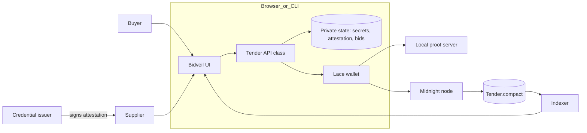

# Bidveil submission pack (drafts)

Fill every `<TODO>` with real results before you submit. Do not claim anything you have not run.

## 1. README draft (copy into `bidveil/README.md` after the contract works)

### Bidveil

Privacy-preserving sealed-bid procurement on Midnight. A buyer publishes a tender, suppliers prove eligibility without revealing their credentials, bids stay sealed, and the buyer reveals only the fields the tender policy allows before recording an award.

### Current state
- Contract: `contract/Tender.compact` compiles with Compact 0.36.0 (language 0.28). `<TODO: yes/no>`
- Tests: `<TODO: N simulator tests passing, which network tests passing>`
- Deployment: `<TODO: Preview or Preprod, contract address>`
- UI: `<TODO: Lace wallet flow or CLI demo>`

### Why privacy matters here
- Competitors never see each other's bids.
- Suppliers prove they qualify (certifications, years in business) without handing over the documents.
- The buyer cannot change the rules after bids arrive: weights, deadlines and the reveal policy are fixed at creation.
- Only the policy-approved fields become public, plus the winning score.

### What is private and what is public
| Data | Visibility |
| --- | --- |
| Supplier credential and attributes | Private (checked inside the proof) |
| Bid price and proposal | Sealed until reveal; then only fields the policy allows |
| Supplier identity | Pseudonymous alias per tender |
| Phase, deadlines, weights, bid count, winner, winning score | Public |

### Architecture
See the diagram in section 2 of `docs/submission-pack.md`, and the full design in `contracts/Tender-design.md`.

### Run it
Prerequisites: Node.js 22, Docker, Compact 0.36.0.
```
compact update 0.36.0
npm install
npm run <TODO: compile script>
npm run <TODO: test script>
docker run -p 6300:6300 midnightntwrk/proof-server:9.0.0
npm run <TODO: deploy script>
```

### Tests
Simulator tests cover: valid flow, invalid credential proof, duplicate bid, duplicate registration, unauthorized reveal, bid after deadline, reveal before review, award with unresolved bids, mask enforcement. `<TODO: results>`

### Known limits
- The buyer can read every bid. Integrity against the buyer is enforced; confidentiality against the buyer is not.
- No revocation list. Credentials expire.
- Preview/Preprod only. Not audited. Not for mainnet.

## 2. Architecture diagram



## 3. Pitch deck outline (8 slides)

1. Problem: public tenders leak bids, private ones lack proof of fairness.
2. Solution: sealed bids with verifiable rules (one sentence plus the lifecycle).
3. Demo screenshot: buyer and supplier views.
4. How privacy shapes the design: private credentials, sealed bids, masked reveal.
5. Architecture diagram.
6. What is built and tested (real numbers, deployment address).
7. Market and viability: who buys (public agencies, enterprises), who issues credentials (KYB providers), path to pilot.
8. Roadmap and ask.

## 4. Demo video script (about 3 minutes)

1. 0:00 Problem in two sentences.
2. 0:20 Buyer creates a tender (show the fixed rules).
3. 0:50 Supplier A registers with a credential, supplier B tries with a bad credential and fails.
4. 1:20 Both submit sealed bids. Show the public ledger: commitments only. Supplier A tries a second bid and fails.
5. 1:50 Deadline passes. Buyer opens review, a non-buyer tries to reveal and fails.
6. 2:15 Buyer reveals, ledger shows only allowed fields. Award goes to the top score.
7. 2:40 Show the contract address, tx hashes and test run.

## 5. Deployment evidence template

| Item | Value |
| --- | --- |
| Network | `<Preview or Preprod>` |
| Compiler / language / runtime | 0.36.0 / 0.28 / 0.21.0 |
| Proof server | midnightntwrk/proof-server:9.0.0 |
| Contract address | `<TODO>` |
| Deploy tx hash | `<TODO>` |
| registerSupplier tx | `<TODO>` |
| submitBid tx | `<TODO>` |
| openReview tx | `<TODO>` |
| revealBid tx | `<TODO>` |
| awardTender tx | `<TODO>` |
| Test log file | `<TODO path>` |
| Demo video | `<TODO link>` |
| Date | `<TODO>` |

## 6. Submission checklist (against the judging criteria)

- [ ] Engineering: compiling contract, TypeScript API, live deployment
- [ ] QA: simulator suite plus one live-network run saved
- [ ] Product and vision: problem and user stated in one paragraph
- [ ] UX: screenshots of both roles
- [ ] Communication: README, diagram, deck, video
- [ ] Business: buyers, issuers, pilot path
- [ ] Current state and what changed since last wave stated plainly
